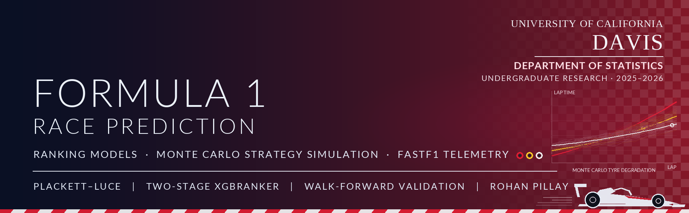

### Undergraduate research, UC Davis Department of Statistics: predicting Formula 1 finishing order with ranking models, telemetry and Monte Carlo race simulation

---

## Results

**~64% of podium finishes predicted** — in stochastic races where race-day events regularly reshuffle the grid.

**Spearman ~0.69 on finishing order** — regularized Plackett–Luce and two-stage XGBRanker ranking models, evaluated with walk-forward cross-validation.

**10,000+ Monte Carlo race simulations** — lap-time variability, tire degradation, pit strategy and stochastic race events, as a base for strategy evaluation.

---

## Overview

This repository contains details about an undergraduate research project focused on statistical and machine learning approaches for Formula 1 race prediction and performance modeling. The project integrates telemetry-derived, qualifying, and race-context features across multiple Formula 1 seasons to model finishing position outcomes, evaluate race strategy, and analyze key performance drivers in stochastic racing environments.

The work covers regularized Plackett–Luce ranking models, probabilistic outcome modeling, feature selection and multicollinearity analysis, and Monte Carlo race simulation frameworks for race strategy evaluation.

## Research Motivation

Qualifying performance is widely believed to be one of the strongest determinants of Formula 1 race outcomes, yet race-day execution, team strength, and driver form introduce substantial variability. This project aims to quantify these relationships, assess their statistical significance, and build predictive models that move beyond descriptive analysis toward actionable race performance forecasting.

## Key Research Questions

- How effectively can telemetry and race features predict Formula 1 race outcomes across multiple seasons?
- What is the relative impact of certain predictors such as qualifying position, driver form, team strength, and track specific factors in determining final race position?
- How do ranking approaches such as Plackett-Luce models compare to traditional predictive modeling frameworks for race outcomes?
- How can stochastic race simulation and probabilistic modeling improve race strategy optimization under uncertainty?

---

## What I did

[Research notes and write-up (Google Doc)](https://docs.google.com/document/d/1vVFXrOgcapsdwYac7s4XwOXEpe7JpVclJWCF34v1KCA/edit?tab=t.0)

| Area | Work |
| --- | --- |
| **Features** | Engineered enriched race-context and qualifying-based features across multiple Formula 1 seasons using FastF1 telemetry and official timing data |
| **Ranking models** | Developed regularized Plackett–Luce ranking models and a two-stage XGBRanker for race outcome prediction and finishing-position ranking across multiple seasons |
| **Validation** | Walk-forward cross-validation: each model is trained only on earlier seasons and tested on later ones (see below) |
| **Feature selection** | Applied feature selection, VIF analysis, correlation analysis, and exploratory statistical evaluation to understand predictor importance and reduce feature redundancy |
| **Evaluation** | Evaluated model performance using ranking and classification metrics including Spearman correlation, Kendall’s Tau, Top-3 accuracy, and NDCG |
| **Simulation** | Implemented Monte Carlo race simulations incorporating lap-time variability, tire degradation, pit strategy, and stochastic race events |

### Why walk-forward validation instead of 5-fold

The first models used standard 5-fold cross-validation. That ignores the fact that this is time-series data: random folds can put a later season in training and an earlier season in testing, so the model is effectively learning from the future. Walk-forward validation fixes this by always training on past seasons and testing on the next one, which matches how the model would actually be used before a race.

---

## Repository Contents

| Folder | What's inside |
| --- | --- |
| [`anlaysis/`](anlaysis/) | PDFs summarizing exploratory analysis, modeling ideas, and research notes |
| [`interactive/`](interactive/) | Interactive HTML visualizations examining relationships between qualifying position, driver form, team strength, and finishing position |
| [`src/`](src/) | Python scripts used for data collection, feature engineering, statistical analysis, and model development |

### Interactive plots (hosted on GitHub Pages)

| Plot | Link |
| --- | --- |
| Qualifying vs Finishing Position | [Open](https://ropillay.github.io/Formula1-Race-Prediction/interactive/F1_2024_Qual_vs_Finish.html) |
| Driver Form vs Finishing Position | [Open](https://ropillay.github.io/Formula1-Race-Prediction/interactive/DriverForm_vs_Finish_PerRace.html) |
| Team Strength vs Finishing Position | [Open](https://ropillay.github.io/Formula1-Race-Prediction/interactive/TeamStrength_vs_Finish_PerRace.html) |

## Data

- Official Formula 1 timing and session data via the **FastF1 API**
- Race results, qualifying data, and race-level context features
- Local caching enabled for reproducibility

## Future Extensions

- Reinforcement learning/multi-agent dynamics to optimize strategy
- Deep learning models for race outcome prediction
- Integration of richer telemetry and strategy features

## Research Paper

A full academic-style LaTeX manuscript documenting the methodology, analysis, and results will be linked here upon completion.

---

## Contact

**Rohan Pillay**
Statistics & Data Science — UC Davis

**Professor Maxime Guiffo Pouokam**
UC Davis Department of Statistics
